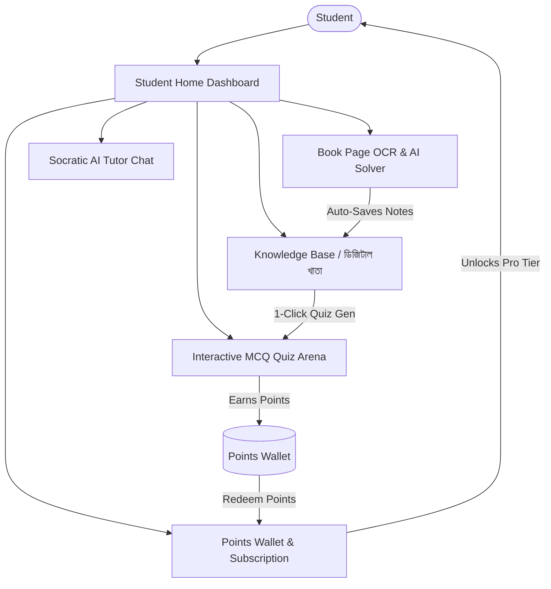

# EduGenius AI - AI-Powered Gamified Learning Platform

EduGenius AI is a modern, mobile-first educational application that empowers students to learn smarter through an AI-driven Knowledge Base, instant textbook page scanner (OCR + AI explanation), a gamified reward point system, interactive MCQ practice arenas, and a flexible points-to-subscription economy.

---

## User Review Required

> [!IMPORTANT]
> **Project Location**: The app will be scaffolded in `C:\Users\HP\.gemini\antigravity\scratch\edugenius-ai` using Vite + React + Lucide Icons + Tailwind CSS for native-app-like mobile responsiveness, fluid animations, and sound effects.

> [!TIP]
> **Points-to-Subscription Economy**:
> - **Join Bonus**: 10 Points on signup.
> - **MCQ / Assignment**: +5 to +15 Points per completed quiz.
> - **7-Day Free Trial**: Full access for 7 days.
> - **Redemption**: Students can redeem **100 Points** to unlock / extend **1 Month of Pro Scholar Membership** without paying real money!

---

## Core Features & Architecture

---

## Proposed Changes & Components

### 1. Project Scaffolding
- Initialize React + Vite project in `C:\Users\HP\.gemini\antigravity\scratch\edugenius-ai`.
- Install `lucide-react`, `canvas-confetti` (for celebration effects), and setup Tailwind CSS with custom sleek dark/light color palette, glassmorphism, and mobile container styling.

### 2. State & Data Layer (`src/context/AppContext.jsx`)
- **Student Profile**: Name, avatar, grade/subject stream.
- **Points & Streaks**: Current points balance, daily streak count, last active date.
- **Subscription Tier**: `Free` (7-day trial expiry tracker) vs `Pro Scholar`.
- **Knowledge Vault**: Stored notes, scanned book pages, summaries, formulas, and tags (Physics, Math, Biology, etc.).
- **Quiz Engine**: Question banks with instant validation, explanations, and dynamic quiz generation from user notes.

### 3. Screen Views & Components
- **`BottomNavigation`**: Mobile app tab bar (Home, AI Tutor, Quiz, Vault, Store/Profile).
- **`DashboardView`**:
  - Top Bar: Streak flame 🔥, Points counter 🪙, Pro Badge 💎.
  - Quick Actions: "Scan Book Page", "Daily Challenge", "Pomodoro Focus".
  - Weakness Radar & Weekly Study Progress Chart.
- **`AITutorView`**:
  - Book Page Scanner (Camera/Upload simulation with rich OCR presets).
  - Socratic AI Chat with interactive hints and multiple tutor personas (*Friendly Mentor*, *Exam Coach*).
  - "Save to My Knowledge Vault" with 1-click.
- **`QuizArenaView`**:
  - Daily Quiz Challenges, Subject-wise MCQs.
  - Instant point rewards with confetti animation and explanation cards.
  - Custom Quiz generator from scanned book pages.
- **`KnowledgeVaultView`**:
  - Digital notebook categorized by subjects and chapters.
  - "Turn into 3-Minute Audio Podcast" player simulator.
  - "Export to Printable PDF Cheat Sheet" feature.
- **`SubscriptionStoreView`**:
  - Free Trial Status (days remaining countdown).
  - Pro Tier Benefits comparison.
  - "Redeem Points for Pro" button with real-time balance check.
  - Refer-a-Friend invite code generator (+25 bonus points).

---

## Verification Plan

### Automated & Build Tests
- Verify Vite build: `npm run build`
- Ensure zero syntax and runtime console errors.

### Manual Verification
- Test 10-point signup bonus initialization.
- Test Book Page OCR upload -> AI explanation -> auto-save to Knowledge Vault.
- Test MCQ Quiz completion -> points increment -> confetti animation.
- Test Points Redemption (100 pts -> 1 Month Pro upgrade).
- Test responsive mobile layout on mobile screens and desktop frames.
